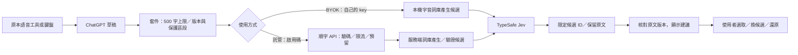

# 0.2.0 資料流與權限邊界

0.2.0 的 Jev 套件與託管服務已整合；0.1.0 Gemini 路徑是歷史基準，不是新版使用前提。真實 Edge／Jev 已在本機合成宿主測試，託管已部署並通過修正及重複請求去重；實際 ChatGPT、真人試用與公開發布 gate 仍未完成。[隱私說明](PRIVACY.md)列出保存與供應商條款。

託管內部可以在伺服器再產生或驗證候選，以伺服器可信資料為準，不相信網頁提供任意替換。圖表示產品資料關係，不承諾所有候選計算都只發生在 content script。

| 資料 | BYOK | 託管版 |
| --- | --- | --- |
| 當前草稿／必要保護詞／候選 | 背景程序直接傳給 Jev | 先經順字 HTTPS `/v1/check`，再送 Jev |
| 供應商金鑰 | 本機 trusted extension storage，Authorization 標頭送 TypeSafe | 私有服務憑證，只在服務端使用，不回傳瀏覽器 |
| 啟用碼 | 不用 | 本機保存，以驗證標頭送順字 |
| 使用者明確選詞偏好 | 本機 paragraphProfile；可清除，持久化需由實際版本驗收確認 | 不上傳完整私人詞庫；以交付版本契約為準 |
| 草稿與候選全文 | 僅校對及還原所需的記憶體暫存，不持久記錄 | 處理期間暫存，不寫入服務／代理日誌或資料庫 |
| 用量 | 本機估算；不回傳順字遙測 | 最少的請求識別、方案期限／次數、狀態、token、費用預留與結算 |

網站不能讀 key、指定任意 API URL、控制驗證標頭或要求回傳憑證。背景程序只接受受限的校對／設定操作，另驗證來源。`chrome.storage.local` 的 `TRUSTED_CONTEXTS` 不等於阻止本機使用者從除錯環境取出金鑰。

產品不讀整段聊天、不錄音、不取得麥克風。啟用後，尚未送出的草稿仍可能因停頓檢查而送到 API。BYOK 沒有順字服務備援；網路、供應商或額度失敗時不改傳其他帳戶。

只有明確選取才可學習選詞偏好，不用使用者沉默或模型決定當標籤。學習更新不應阻止已顯示 review 的還原；續打造成原文不一致時則捨棄舊結果，避免覆寫。

公開詞庫及 [third-party notices](../third_party/mcbopomofo-web/README.md) 可隨包散布。API key、啟用碼、預算帳本、私人草稿與試用聯絡表不可進 ZIP、公開 repo 或匯出設定。開發用 `.local` 合成 smoke 報告不是產品資料庫，也不可當成正式遙測機制。
