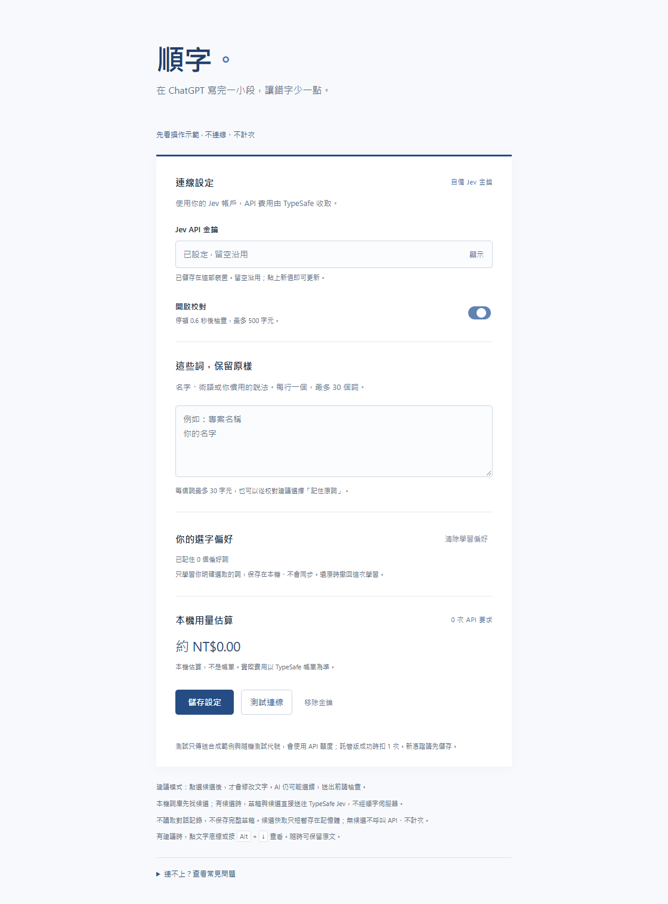
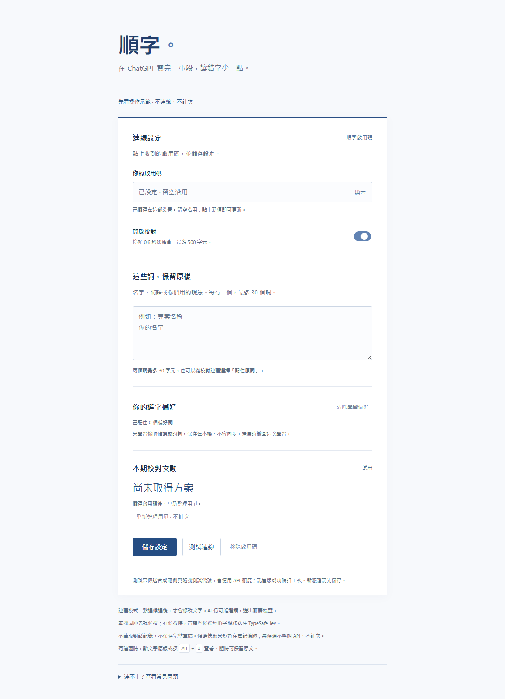
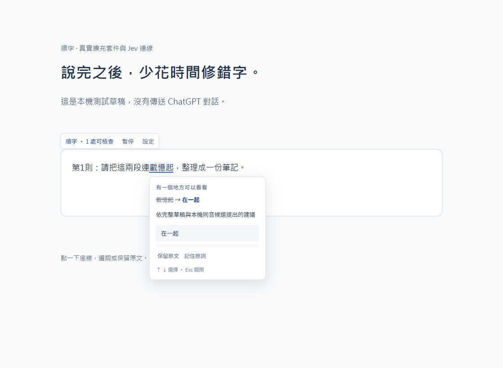

# Jev BYOK／託管版安裝圖文說明（0.2.0）

已附真實套件設定與本機測試頁的候選圖片，**仍未完成他人只依文件自助安裝驗收**。BYOK 包為 `shunzi-byok-0.2.0.zip`，託管包為 `shunzi-hosted-0.2.0.zip`，交付須附同版 `SHA256SUMS`。公開 Release 尚未發布；以下是已通過兩次可重現建置與發布掃描的本機包校驗值。

| 套件 | SHA-256 |
| --- | --- |
| shunzi-byok-0.2.0.zip | `31742cb258723925524e9246b4f0b9bfd616b77bc206e9f4f6a72b52f2da92bd` |
| shunzi-hosted-0.2.0.zip | `8aa23f9c7a13481c3a279eb1b3774fb5d1df5f4816194e9b235352eb868f65c8` |

## 安裝與首次校對

1. 將 ZIP 完整解壓到固定資料夾，核對 SHA-256；不要刪掉解壓後資料夾。
2. 到 Chrome 的 `chrome://extensions` 或 Edge 的 `edge://extensions`，開啟「開發人員模式」。
3. 按「載入未封裝項目／載入解壓縮」，選直接含有 `manifest.json` 的資料夾。
4. 固定順字至工具列，開啟設定。核對 0.2.0；BYOK 顯示 Jev API 金鑰，託管版顯示啟用碼。若看到 Gemini，使用的是舊包。
5. 託管版貼上維護者提供的啟用碼並儲存。BYOK 則從 [TypeSafe 控制台](https://console.typesafe.ai/)自行取得 key，貼入設定並儲存；不要提供給維護者，也不要截下完整 key。
6. 閱讀草稿會送給 Jev 的說明，再啟用校對。測試連線可能產生費用。
7. 重新整理 ChatGPT，輸入 `我明天在回覆你。`，完成選字後停一下；若出現候選，選「再」，再試一次還原原文。若沒有候選，按 [FAQ](FAQ.md) 排查，不要把「沒反應」填成成功。

託管包改用維護者提供的啟用碼，不要求申請 Jev key。託管試用及收費仍受 [門檻](PILOT.md) 約束。

## 實機設定與候選圖片

以下三張圖片均已核對。設定頁屬於實際擴充套件；候選畫面使用真實 Edge 擴充套件與 Jev，但宿主是**本機合成草稿頁**，不是實際 ChatGPT 對話，也不是錄音或語音辨識測試。

| 圖 | 檔案 | 畫面與圖說 | 狀態 |
| --- | --- | --- | --- |
| 1 | [BYOK 設定](assets/options-byok.png) | 使用自己的 Jev key，API 帳單由 TypeSafe 收取 | 已提供 |
| 2 | [託管設定](assets/options-hosted.png) | 使用啟用碼，查看期限及剩餘次數；不需申請 API | 已提供 |
| 3 | [候選畫面](assets/candidate-review.png) | 本機合成測試頁上的真實候選；點選才改、可保留或還原 | 已提供 |

### 自備 Jev 金鑰設定

### 託管啟用碼設定

### 本機合成草稿頁的候選

操作影片見 [WebM](assets/shunzi-demo.webm) 與[錄製環境說明](DEMO-VIDEO.md)。瀏覽器管理頁的安裝步驟目前以文字提供，沒有另附其截圖。

本機合成草稿頁的圖片只能說明候選操作，不代表真實 ChatGPT 宿主已驗收。至少一位未被口頭教學的測試者，只依 README／本頁完成首次安裝、校對及還原，才能在 PILOT 填「自助安裝通過」。安裝者代號、日期、版本／SHA、卡住步驟及重做結果目前均待填。
